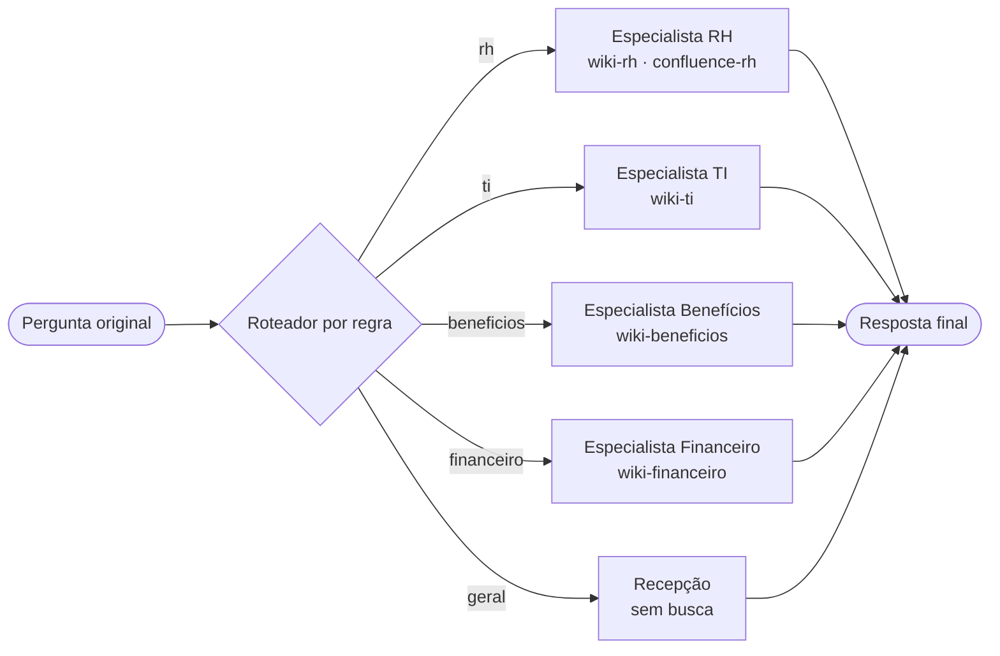

# Nota de arquitetura · Encontro 4

**Equipe:** BEEFIM

**Integrantes:**

- 373155 EDUARDO LAGO
- 374640 BRUNA CARLA PEREIRA
- 369873 ELIAS MAX LOPES
- 373300 FELIPE HENRIQUE DE ALBUQUERQUE
- 375303 IGOR DA SILVA FERRAZ
- 375217 MATHEUS MENEZES MANFRIN

## 1. O padrão escolhido

**Padrão:** roteador regra · 4 esp · original · incerto→segue

**Configuração:**

```json
{
  "arquitetura": "roteador + especialistas",
  "roteador": "regra",
  "equipe": 4,
  "handoff": "pergunta_original",
  "se_incerto": "seguir"
}
```

## 2. O diagrama



## 3. O placar

| arquitetura | acertos | rota certa | chamadas/caso | tokens/caso | custo total (US$) | custo/acerto (US$) | seg/caso |
| ----------- | ------- | ---------- | ------------- | ----------- | ----------------- | ------------------ | -------- |
|             |         |            |               |             |                   |                    |          |

| arquitetura                                       | acertos | rota certa | chamadas/caso | tokens/caso | custo total (US$) | custo/acerto (US$) | seg/caso |
| ------------------------------------------------- | ------- | ---------- | ------------- | ----------- | ----------------- | ------------------ | -------- |
| roteador llm · 3 esp · original · incerto→segue   | 16/19   | 14/17      | 3.1           | 2588        | 0.0599            | 0.00375            | 3.2      |
| roteador regra · 3 esp · original · incerto→segue | 16/19   | 14/17      | 2.0           | 2279        | 0.0506            | 0.00316            | 2.1      |
| supervisor · 3 esp                                | 17/19   | 15/17      | 3.9           | 3370        | 0.079             | 0.00465            | 4.2      |
| agente único (Aula 3)                             | 16/19   | 17/17      | 2.6           | 3007        | 0.0655            | 0.00409            | 2.7      |
| roteador regra · 4 esp · original · incerto→segue | 17/19   | 15/17      | 1.7           | 1360        | 0.0326            | 0.00192            | 1.9      |
| supervisor · 4 esp                                | 16/19   | 14/17      | 4.4           | 4218        | 0.0957            | 0.00598            | 4.7      |

## 4. A divisão se paga?

Sim, nesta rodada a divisão com roteador por regra e quatro especialistas se paga: os acertos passaram de 16/19 no agente único para 17/19, e o custo por acerto caiu de US$ 0,00409 para US$ 0,00192, uma redução de aproximadamente 53%.
Também houve redução de 2,6 para 1,7 chamadas por caso e de 2,7 para 1,9 segundos por caso.

O limite entre especialistas é real, não apenas uma orientação no prompt: cada agente só pode consultar documentos dos departamentos definidos para sua atuação.

Essa divisão atende ao controle de acesso por fonte e permite auditar pelo trace quais agentes e ferramentas participaram, mas a rota certa ficou em 15/17 contra 17/17 do agente único, mostrando que ainda há falhas de encaminhamento.

O ganho não vale para qualquer divisão: o supervisor com quatro especialistas manteve 16/19 acertos e elevou o custo por acerto para US$ 0,00598, por isso defendemos especificamente o roteador por regra com quatro especialistas.

## 5. Um caso, aberto

**Caso:** P1

**Causa:** Rota errada (tratamento da saudação). O supervisor não tratou o P1 como uma interação de recepção e encerrou com "nao_sei", quando deveria responder. O trace mostra que recebeu a pergunta completa e não delegou.

**A linha do trace que mostra a causa:**

```
P1 · Bom dia! Você consegue me ajudar com dúvidas de RH e TI?
arquitetura: supervisor · 4 esp

  [supervisor] recebeu: Bom dia! Você consegue me ajudar com dúvidas de RH e TI?
  [supervisor] modelo pediu: responder   (780 tokens de entrada, 48 de saída)
  [supervisor] encerrou: nao_sei · fontes [] · “Não sei. Você pode perguntar sobre RH ou TI, que eu verifico as informações com os especialistas.”

resultado: ERROU (desfecho 'nao_sei', esperado 'responder')
custo por agente:
  supervisor                1 chamadas ·    780 +   48 tokens · US$ 0.00102
```

<!-- ## 6. Para o domínio da equipe (opcional) -->

<!-- Só para quem trocou o caso pelo domínio da própria empresa: em duas ou três frases, onde ficariam
     os limites entre especialistas no domínio de vocês, e que fonte cada um poderia ou não enxergar. -->
